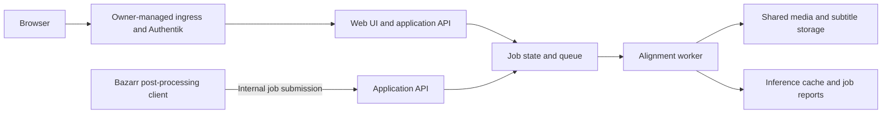

# Bazarr Better Sync — Product and Engineering Specification

Status: requirements baseline; implementation choices remain open where identified below.

Date: 2026-10-29

Repository: https://github.com/burakemirsezen/bazarr-better-sync

## 1. Purpose

Build a subtitle alignment companion for upstream Bazarr that improves the reliability of English subtitle timing. The primary use case is high-quality English subtitles downloaded from OpenSubtitles for media with English audio. Turkish subtitles are a secondary, future concern.

The system should use the existing subtitles as the authored content and derive reliable timing evidence from the media. It must be evaluated against actual problematic files before claiming an improvement over Bazarr's existing ffsubsync workflow.

This repository starts with a specification. Creating an application, container image, or deployment is subsequent work, not an outcome already delivered by this document.

## 2. Decisions confirmed with the owner

| Area | Confirmed decision |
| --- | --- |
| Repository | Public repository named `burakemirsezen/bazarr-better-sync`. |
| Bazarr | Keep using upstream Bazarr; no separately maintained fork. |
| Integration | A small custom post-processing client submits queued jobs and returns promptly. |
| Job interaction | Progress, results, reports, and retries are available in the companion's web UI. |
| First-version languages | English subtitle alignment against English audio. Turkish is deferred. |
| First-version formats | SRT, ASS, and SSA. |
| Uncertain automatic results | Keep the original subtitle; expose the reason and correction controls in the UI. |
| Manual controls | Job reports, retry, audio-track selection, and manual timing anchors entered as timestamps. |
| Media preview | An embedded video player is outside the selected first-version UI scope. |
| Compute | CPU operation first, with the code structured to allow GPU inference backends later. No GPU requirement for the first version. |
| Runtime environment | Containerized service intended to run in Kubernetes. |
| Deployment deliverables | Container image and operating documentation. The owner manages Kubernetes deployment separately; no Helm chart or Kubernetes manifests are requested. |
| File access | Shared media storage mounted into the service, with configurable mappings from Bazarr paths. Media upload/download is not required. |
| Browser authentication | Authentik in front of the application, configured by the owner. No application-managed login or accounts. |
| Bazarr API access | Direct internal Kubernetes connection with no application authentication; access restrictions belong to the owner's deployment. |

Later decisions must be recorded explicitly. An item in the open-decisions section is not permission to select an arbitrary default.

## 3. Scope and boundaries

### First-version product scope

- Accept work submitted after a Bazarr subtitle download through its existing custom post-processing facility.
- Align English SRT, ASS, and SSA subtitles against a selected English audio track.
- Correct supported timing problems while preserving the authored subtitle content and presentation.
- Show queued and running work, completion outcomes, uncertain results, and failures.
- Allow a user to select the audio reference, retry a job, and supply manual timing anchors.
- Work on CPUs and expose a clean boundary for future GPU-capable inference implementations.
- Read media and update subtitles through configured shared-storage paths.

### Deferred or unselected scope

- Turkish or other translated-subtitle alignment.
- GPU execution, including Intel iGPU support.
- Embedded browser video playback or media streaming.
- Subtitle generation, translation, or rewriting as a replacement for the downloaded subtitle.
- Replacing Bazarr's built-in manual Sync button.
- A Bazarr fork, custom Bazarr distribution, or mandatory upstream code changes.
- Media uploads and corrected-file downloads as the normal integration mechanism.
- Helm charts, Kubernetes manifests, ingress deployment, Authentik configuration changes, or live-cluster changes.

Batch import of an existing library, scheduled rescans, automatic subtitle re-downloads, and direct media-player refresh integrations have not been requested. They remain open scope decisions rather than implicit first-version features.

## 4. Bazarr integration contract

The post-processing client receives the video path, subtitle path, and available language/context metadata from Bazarr's existing command substitutions. Exact command syntax and API routes will be specified during implementation.

The intended sequence is:

1. Bazarr downloads and saves a subtitle normally.
2. Its configured post-processing command invokes the submission client.
3. The client submits the job using the internal service address.
4. The service acknowledges acceptance and returns a job identifier after the job has been recorded for processing.
5. The client returns to Bazarr without waiting for transcription or alignment.
6. The worker processes the mounted files and records the result.
7. The user inspects the result or performs a retry/manual correction in the web UI when necessary.

Bazarr's built-in automatic sync should be disabled when this service is responsible for automatic alignment. Post-processing score thresholds must be configured so that high-scoring subtitles are not inadvertently excluded; Bazarr's release-match score is not evidence that subtitle timing is correct.

The documentation must explain that this hook applies to the supported download flow. It does not replace the built-in manual Sync button or automatically enqueue every subtitle already present in the library.

Because work is asynchronous, a player may initially see the original subtitle. Job completion must be visible in the companion UI. Whether a particular media server requires a refresh to observe later subtitle changes must be verified separately; the initial integration must not promise refresh behavior it does not implement.

The submission client needs a bounded request timeout and actionable output for submission failures. A successful submission means the job was accepted, not that alignment has succeeded. Retry and duplicate-submission semantics must be specified before implementation.

## 5. Logical architecture

These are logical responsibilities, not a decision to deploy separate containers or external services. Process topology, storage technology, queue implementation, UI framework, and backend language are still open.

### Required responsibilities

- **Submission client:** pass input references and supported metadata, handle acknowledgement and connection failures, and return promptly to Bazarr.
- **API:** validate submissions, expose job state and reports, and accept retry and manual-anchor actions.
- **Job coordination:** control concurrency, identify repeated work, and report interruption/recovery outcomes.
- **Worker:** inspect input files, select or accept an audio reference, obtain timing evidence, align, validate, and publish a supported result.
- **Web UI:** present enough evidence for a user to understand an outcome and correct it without editing subtitle files manually.
- **Inference backend interface:** isolate model loading, device selection, transcription/alignment output, and inference-specific configuration from job orchestration and subtitle editing.

## 6. Alignment approach to evaluate

The following is an engineering proposal for evaluation, not a selection of a particular model or library:

1. Inspect the media and enumerate audio tracks. Record the chosen track in the job report. Selection rules for ambiguous, missing, dubbed, or commentary-track metadata must be decided explicitly; the user must be able to override the choice.
2. Parse subtitle cues without discarding text, formatting, styles, or unrelated metadata.
3. Obtain timestamped English speech evidence from the selected audio track. Reuse valid cached evidence when possible.
4. Match distinctive subtitle passages to the recognized dialogue in sequence, tolerating recognition errors, punctuation differences, condensed wording, and missing passages.
5. Infer timing anchors and test supported correction models: constant offset, global drift, and changes between sections when the evidence supports them.
6. Derive cue timings while preserving sensible display durations and the source's intended presentation. Word timestamps are evidence; they are not automatically a caption's exact display boundaries.
7. Validate the proposed result across the media, including regions not used to fit the correction. Produce a report explaining support, uncertainty, and changes.
8. Install a successful result according to an explicitly defined file-update policy. If evidence is insufficient, preserve the existing subtitle and expose the job for review.

WhisperX, CPU-capable Whisper implementations, ffsubsync, and alass are candidates to assess. No candidate is mandated by this spec, and no model size, precision, or performance claim has been selected.

The system must not assume that a high-quality subtitle is a verbatim transcript, that every line corresponds to speech, or that every subtitle cue has a one-to-one transcript match. Repeated phrases, songs, overlapping speakers, sound-effect captions, sparse/forced subtitles, and different video edits belong in evaluation.

A subtitle cannot restore dialogue absent from the video. Different edits can require a partial alignment or an uncertain outcome rather than a confidently incorrect rewrite.

## 7. Subtitle preservation and file handling

The product goal is timing correction, not content regeneration. English subtitle wording, cue order, styles, speaker information, and non-dialogue content should survive processing.

SRT, ASS, and SSA must have separate preservation checks. ASS/SSA styles, event fields, override tags, and intentional overlaps must not be flattened into SRT or silently normalized. Handling of embedded time-dependent constructs such as karaoke and animation needs an explicit implementation decision. Unsupported constructs must be reported rather than silently corrupted.

Shared-storage integration must account for:

- Mapping Bazarr's submitted paths to the worker's mount paths, with explicit configured roots.
- Read access to media and appropriate write access to subtitle destinations.
- Subtitle encodings, filenames, and formats.
- The subtitle being replaced or upgraded while a queued job is waiting or running.
- Concurrent jobs targeting the same subtitle.
- Restarts, cancellation/interruption, and write failures.

Before an automatic write, the worker must ensure it is still modifying the intended input version and avoid publishing a partial file. The exact locking, replacement, original-backup, rollback, and retention mechanisms remain open engineering decisions and must be resolved before enabling writes.

## 8. Web UI and manual timing anchors

The UI must expose a job list, job detail/report view, retry control, audio-track selection, and timestamp-based anchor entry. It does not require a browser video player.

A job report should distinguish an unchanged/already-aligned result, an applied correction, an uncertain result needing review, and an operational failure. Reports should identify the inputs, audio track, processing stage, proposed/applied timing changes, supporting matches, and unresolved regions. Exact status names and the confidence presentation are not selected yet; an uncalibrated score must not be presented as a guaranteed probability of correctness.

### Manual interaction

1. Open an uncertain job and review the report.
2. Select or confirm the intended audio track.
3. Select a subtitle cue and enter the time at which it should occur, using the owner's normal media player to find that time.
4. Add further anchors when needed to describe drift or separate timing sections.
5. Run a constrained retry and inspect its proposed changes and validation report.

The anchor UI must make the timestamp's meaning explicit, such as the selected cue's intended start time. It must validate anchor order, media bounds, and contradictory entries.

One anchor can support an offset correction; two or more can constrain drift. Cuts may require anchors in separate sections. An anchor does not prove that every intervening subtitle matches the audio.

The exact anchor interpolation/section rules, preview representation, and whether users explicitly approve manually derived output before it replaces the active subtitle remain open decisions. Manual input must not bypass file consistency checks.

## 9. CPU first; GPU path later

The first implementation and container image must operate without a GPU. No CUDA dependency or GPU device must be mandatory to start the service or run a job.

Inference configuration and execution must be isolated behind a backend boundary so that future GPU support does not require rewriting the queue, API, subtitle parsers, or manual-anchor UI. Backend/device/model identity must be included in relevant cache metadata and diagnostic reports.

An Intel iGPU is available in the intended environment, but its model and compatibility are not established. Intel acceleration is a future capability, not a promised first-version backend.

CPU throughput, memory use, and acceptable turnaround time must be measured on representative hardware and media. The specification deliberately sets no invented core count, RAM limit, concurrency default, or minutes-per-episode target.

Caching should avoid repeating expensive speech analysis for the same valid media/audio input. Cache identity, invalidation, storage size, eviction, and retention need explicit decisions; a filename alone is insufficient evidence that content is unchanged.

## 10. Container and Kubernetes operating contract

The implementation must provide a reproducible container build and document how to run the resulting image in the owner's Kubernetes environment. Deployment resources are maintained elsewhere by the owner.

The operating documentation must describe:

- Supported image architectures and tags once chosen.
- Start command and process modes once the runtime topology is chosen.
- Network listener and health/readiness interfaces.
- Shared media mounts, path mappings, and filesystem permissions.
- Persistent job data, inference/model cache, temporary space, and reports/backups as applicable.
- Configuration inputs and their meanings, including CPU concurrency/resource controls.
- Startup/model preparation, job interruption/recovery, and upgrade compatibility.
- Logs and diagnostic data needed to investigate failures.
- The trusted-ingress and internal-API deployment boundary described below.

Container registry, image publishing workflow, base image, model download strategy, numeric resource settings, ports, and volume paths remain unselected. Building an image must not imply deployment to the owner's cluster.

## 11. Access boundary: Authentik and internal API

The application will not implement its own accounts, password storage, interactive login, or API authentication. This replaces the earlier built-in-authentication request.

- Browser access goes through owner-managed ingress protected by Authentik.
- The Bazarr submission client uses the internal Kubernetes service directly, without interactive login or application credentials.
- The owner manages restrictions on direct service access so that the external route cannot bypass Authentik and untrusted workloads cannot reach the unauthenticated API.
- The application must document that direct access grants its supported operations; a private service address alone is not a user-authentication mechanism.
- The UI and state-changing API actions still require ordinary request validation. The implementation must resolve browser request-origin/CSRF behavior for the reverse-proxy deployment.

Forwarded identity headers, per-user auditing, and application roles are not required or selected. If added later, they need an explicit trusted-proxy contract; client-supplied identity must not silently become authorization.

No Authentik, ingress, network-policy, or cluster change is part of the current repository/specification task.

## 12. Evaluation and acceptance plan

The intended benefit is fewer incorrect alignments and fewer harmful automatic changes. Success must be demonstrated, not inferred from a model's transcription accuracy or a tool's exit status.

Create a representative, owner-approved evaluation set covering:

- Subtitles already correctly aligned.
- Constant delay and progressive drift.
- Recaps/intros, missing or additional scenes, and abrupt timing changes.
- Condensed/paraphrased English subtitles and recognition mistakes.
- Repeated dialogue, silence/music, overlapping speech, and non-dialogue cues.
- All three requested formats, including ASS/SSA preservation cases.
- Incorrect audio-track selection and a corrected manual retry.
- Manual-anchor workflows.

Compare the companion with Bazarr/ffsubsync under recorded settings. Evaluate independent timing references distributed across the media; do not validate only on the anchors used to fit a correction.

Measure cue timing error, alignment coverage, harmful changes to already-correct subtitles, uncertain/rejected cases, runtime, and peak memory. Agree on the benchmark set and numeric pass criteria with the owner before using the results as a release gate.

Operational verification must cover submission acknowledgement, duplicate requests, worker interruption, stale inputs, concurrent updates, path mappings, inaccessible storage, malformed files, and the agreed replacement policy. Container checks must demonstrate CPU operation without GPU devices and the documented health/configuration interfaces.

No live-media corpus, credentials, or private infrastructure configuration should be committed as test fixtures to this public repository.

## 13. Open decisions — ask before selecting

| Decision | Current status |
| --- | --- |
| Backend language, API framework, and UI framework | Not selected. |
| ASR/word-alignment engine, model, precision, and languages of audio detection | Not selected; benchmark candidates first. |
| Use of external AI services / inference locality requirements | Not explicitly settled; no external service integration has been selected. |
| Optional fast alignment using ffsubsync/alass | Candidate approach only. |
| Queue, persistent state, runtime topology, restart/retry policy | Not selected; acknowledge accepted work durably and define recovery semantics before implementation. |
| Ambiguous audio-track selection rules | Not selected; manual selection is required. |
| Treatment of sparse/forced subtitles and advanced ASS time-dependent tags | Must be specified and tested; no silent conversion. |
| Successful-result replacement, backup/rollback, and retention policy | Not selected. Uncertain automatic results must keep the original. |
| Manual-anchor model and final apply/approval interaction | Not selected. |
| Confidence thresholds and benchmark release criteria | Not selected; require evidence and owner agreement. |
| CPU/RAM budgets, concurrency, turnaround expectations | Not selected; measure on the intended node. |
| Target container architectures, registry, tag policy, publishing workflow | Not selected. |
| Cache/model provisioning, retention, reports, temporary-space limits | Not selected. |
| Existing-library batch processing or media-server refresh | Scope not selected. |
| Software/documentation license | Not selected; do not add a license by assumption. |

These open choices do not prevent publishing this specification. They prevent treating the specification as approval for unchosen implementation defaults.

## 14. References and current integration observations

Reviewed on 2026-10-29. Upstream branch links can change; verify behavior against the installed Bazarr version during implementation.

- [Bazarr subtitle settings and custom post-processing](https://wiki.bazarr.media/Additional-Configuration/Settings/Subtitles/) documents the hook and command substitutions.
- [Bazarr post-processing implementation](https://github.com/morpheus65535/bazarr/blob/master/bazarr/subtitles/post_processing.py) waits for the command via `communicate()` with no explicit timeout in the inspected function. The queued submission client must therefore return promptly and implement its own request timeout. In the inspected version, output/error logging is not a rich job-result integration.
- [Bazarr subtitle processing flow](https://github.com/morpheus65535/bazarr/blob/master/bazarr/subtitles/processing.py) applies existing sync before custom post-processing and performs subsequent notifications. Later companion completion does not automatically reuse that notification sequence.
- [Bazarr sync integration](https://github.com/morpheus65535/bazarr/blob/master/bazarr/subtitles/tools/subsyncer.py) calls ffsubsync; FFmpeg is used for media handling.
- [ffsubsync](https://github.com/smacke/ffsubsync) provides the existing alignment baseline and subtitle-reference support.
- [alass](https://github.com/kaegi/alass) supports offsets, framerate differences, and splits; it is an evaluation candidate.
- [WhisperX](https://github.com/m-bain/whisperX) provides timestamped speech recognition/word alignment and CPU execution; it is a candidate, not a selected dependency.
- [faster-whisper](https://github.com/SYSTRAN/faster-whisper) documents its inference options. Its documented GPU route uses NVIDIA libraries; Intel iGPU support must not be assumed from the word GPU.
- [Authentik forward authentication](https://docs.goauthentik.io/add-secure-apps/providers/proxy/forward_auth) explains the external browser-authentication pattern. The selected Bazarr API route is direct/internal and does not require Authentik machine credentials.
