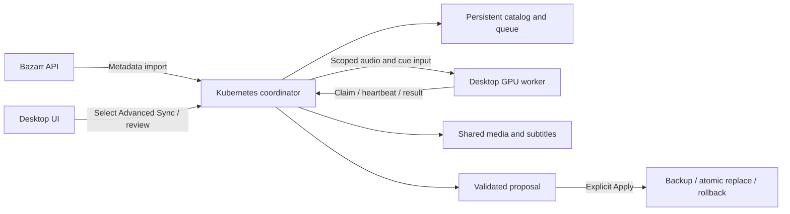

# Bazarr Better Sync — Product and Engineering Specification

Status: target design for the transition from the CPU prototype to a Kubernetes coordinator and desktop GPU worker. Updated 2026-10-31. The design below is a requirement, not a claim that the distributed system exists.

Repository: https://github.com/burakemirsezen/bazarr-better-sync

## 1. Goal and current boundary

Repair timing in otherwise useful English subtitles from Bazarr while retaining their wording and presentation. Use local audio evidence to derive individual cue starts and ends, including different gaps between cues and timing changes across edits. Do not force every repair into a constant offset or global time stretch.

The owner has paused the current live repair campaign. No further library repair is part of the architecture transition or concept benchmarks. Existing repairs and their rollback backups stay intact. Experiments must use read-only media and scratch proposals, and must not Apply to the library.

Before implementing the full distributed application, demonstrate the timing concept convincingly on real failures and already-correct controls. Models, alignment algorithms, and precision are open choices. Larger models and substantial local compute are authorized when compatible with the available desktop GPU; a current prototype dependency does not constrain selection.

## 2. Confirmed product decisions

| Area | Direction |
| --- | --- |
| Bazarr | Upstream Bazarr remains; no fork or replacement Sync button. |
| Invocation | Optional Advanced Sync for explicitly selected episodes, movies, or seasons. |
| Catalog | Import metadata through Bazarr's API; never read its database directly. Import creates no analysis jobs and changes no subtitle. |
| Server | One persistent Kubernetes coordinator owns catalog, queue, source identity, audio preparation, validation, proposals, Apply, backups, and rollback. No required external database/broker. |
| Desktop | Windows application with a UI and GPU worker; connects outward to the coordinator, claims jobs, and returns timing proposals. |
| Hardware | Initial desktop target: AMD Radeon RX 7800 XT. Cluster CPU remains useful for coordination/audio preparation; desktop GPU inference is the new primary experiment. |
| Language/formats | English audio with external English SRT/ASS/SSA first. Turkish alignment remains deferred. |
| Content | Preserve downloaded wording, cue identity/order, formatting, styles, speaker and non-dialogue content. |
| Publication | Review and explicit Apply initially. Future automatic publication is separately opt-in and gated by real quality evidence and agreed release criteria. |
| Locality | Media, subtitles, and inference stay on owner-controlled systems. Model downloads are permitted; external AI processing is outside scope. |
| Availability | Desktop may be offline. Queued jobs persist; normal Bazarr downloads and playback continue. |
| Deployment | Container and operating documentation for the coordinator; Windows desktop packaging after concept validation. Owner maintains Kubernetes deployment. |

The earlier CPU-first, single-process worker design is superseded as the target architecture. The existing implementation remains an experimental baseline. No GPU backend, model, desktop framework, or production network route is selected by this document.

## 3. Workflow and responsibilities

1. Bazarr saves subtitles normally. A catalog refresh reconciles metadata without inference or publication.
2. The user selects exact eligible targets and confirms the count and intended audio track. Selection must not expand silently to a series or the library.
3. The coordinator records a durable job with source identities. It prepares only the audio required by the selected experiment/backend.
4. An available desktop worker claims a compatible job under a renewable lease. The UI shows preparation, transfer, alignment, validation, and review status separately.
5. The worker obtains speech/alignment evidence and produces a timing map tied to the original cue identities. It reports unmatched or unreliable regions rather than inventing dialogue or forcing a match.
6. The coordinator verifies the result contract, source versions and lease, renders original content with proposed timestamps, and stores an immutable reviewable proposal.
7. The user reviews timing changes and unresolved regions. Apply checks the same proposal and source versions again, preserves the original, and publishes atomically. Rollback refuses to overwrite a newer file blindly.

The coordinator is the sole publisher. The desktop never needs a writable library mount or Bazarr API key. Closing the UI or losing a worker must not corrupt files or lose an accepted job.

## 4. Alignment concept and model selection

Use the existing text as authored content and speech recognition/forced alignment as timing evidence. Evaluate direct text-to-audio alignment, ASR followed by text matching/alignment, and coarse search followed by local refinement. Transcription accuracy alone does not establish good caption timings.

The output must support independent cue start/end changes and altered inter-cue gaps, with local offsets/sections as useful special cases. A short speech-dominated sample may establish a coarse offset, but cannot certify an entire episode when later edits change timing. Sample multiple separated regions and expand analysis when evidence disagrees. Full-audio processing is allowed when it improves results within the chosen GPU budget.

Candidate selection must measure actual Windows/AMD compatibility, model and alignment licenses, model size/precision, VRAM, RAM, warm/cold latency, and timing quality. Do not assume a CUDA-only dependency works on this GPU. A Vulkan-capable engine is a candidate, not an implemented or selected backend. No model download or inference should begin simply because the catalog/UI starts.

Handle paraphrased/condensed lines, repeated dialogue, missing scenes, music, silence, overlapping speakers, names and sound-effect captions. Keep authored overlaps where intentional; monotonic dialogue matching does not mean every cue interval must be disjoint. Distinguish missing evidence, incompatible source edition, already aligned, and operational failure. No context model may silently rewrite the user's subtitle.

Incomplete/truncated subtitle sources require an explicit separate source-replacement action. Timing repair must not synthesize the missing wording. Advanced ASS/SSA karaoke/animation constructs must be preserved correctly or flagged unsupported when a duration change would break them.

## 5. Coordinator and worker protocol requirements

Define a versioned protocol before distributed implementation. The following are required semantics; exact endpoints and field names remain implementation work.

| Object/action | Required content/behavior |
| --- | --- |
| Worker registration | Protocol version, device/backend capabilities and available resources; stable worker identity separate from an authorization secret. |
| Job identity | Durable job ID, explicit selected target, retry/attempt ID, subtitle SHA-256 and cue count, media version identity, selected audio stream and processing recipe. |
| Claim | Atomic queue claim, unique lease/attempt token, server expiry and heartbeat policy. Only compatible workers may claim. |
| Audio artifact | Job-scoped artifact ID, checksum, byte/sample bounds, channel/sample-rate/encoding description, selected stream and exact mapping from artifact sample time to media time. |
| Cue input | Stable zero-based cue identity and original times/text needed for alignment, tied to the exact source hash. Never accept a worker-supplied destination path. |
| Result | Idempotency/result ID, job/attempt/lease identity, input hashes, model/backend/version/precision/configuration, per-cue start/end map, unresolved regions, diagnostics and resource timings. |
| Result acceptance | Strict schema/count/index/size/numeric checks, source and artifact identity checks, current lease check, and durable acknowledgement. Receiving a result cannot Apply it. |
| Review/Apply | Immutable proposal ID and rendered-output hash; stale previews/results cannot authorize a different proposal. |

Use at-least-once work execution with idempotent result acceptance, not a claim of exactly-once network delivery. A repeated identical result returns its prior acknowledgement. A conflicting duplicate or expired/replaced attempt is rejected. Cancellation revokes publication authority immediately, even if a disconnected GPU process finishes later.

Jobs wait when no worker is available. Expired leases leave an auditable interrupted attempt and make retry possible under a bounded documented policy; avoid endless automatic expensive recomputation. Heartbeats and progress must be small requests independent of audio transfer. Coordinator restarts preserve accepted jobs/results and reconcile leases. Desktop restart/crash removes abandoned scratch artifacts according to safe ownership rules.

Record immutable media content identity for reusable audio and proposals. A path/mtime/size observation alone is not a cryptographic content guarantee; the implementation must document how it detects replacements and binds extraction to the validated media version without rehashing unnecessarily. Exact subtitle hashes are mandatory at submission, result validation, Apply and rollback boundaries.

No external broker, GPU in Kubernetes, shared desktop filesystem, desktop inbound port, or always-on desktop is required. CPU inference fallback may be an explicit option; do not silently run costly full-episode CPU analysis when the GPU is offline.

## 6. Audio transfer and storage

The server reads configured media roots and maps Bazarr paths internally. Deliver audio artifacts over the worker connection rather than transfer whole video files by default. Compare chunked speech windows and full selected-track audio experimentally; retain accurate sample/time mapping through trimming or resampling.

Transfers must be bounded, checksummed and retryable; workers cannot request arbitrary server paths or remote URLs. Bound artifact preparation, pending disk use, upload size, cue count, job duration and simultaneous processing. Numeric deployment budgets remain to be measured/selected. Interrupted/partial transfers are never treated as valid cached input.

Models are persistent explicitly provisioned assets. Audio extracts, transcripts and worker scratch are temporary by default and distinct from durable reports and recovery backups. Every experiment uses an owned workspace and a finally cleanup path; cancellation/failure must also remove it. Verify leftover processes, artifacts and temporary cluster resources at completion. Startup cleanup may remove only recognized abandoned scratch entries, never arbitrary user paths. Retention settings must not silently delete the only rollback copy.

## 7. File preservation and publication

The server parses and renders the original subtitle; the desktop returns timings, not an authoritative replacement file. Validate that every expected cue is accounted for, untouched regions remain untouched, finite starts precede ends, media bounds and format precision are respected, and non-timing bytes/content are preserved under the format's lossless representation.

SRT/ASS/SSA have separate preservation checks for encoding/BOM, line endings, event fields, styles, override tags, cue text and intentional overlaps. No implicit conversion to SRT or whitespace/text normalization. Unsupported or malformed input produces an actionable outcome.

Before Apply, verify subtitle/media/audio identity and serialize publishers for that target. Write an exact original backup plus recovery metadata before atomic replacement; verify readback and store the applied hash. Avoid concurrent Bazarr/editor writes during publication. Document that external writers do not honor application locks and portable hash checks plus rename cannot completely remove that race.

Rollback verifies backup integrity and that the active subtitle is still the expected applied version, preserves the displaced version, and records the recovery result. Review edits/manual anchors must pass the same preservation, source-version and publication checks. No experimental benchmark may call publication endpoints.

## 8. UI and access boundaries

The desktop UI shows connection/GPU state, catalog filtering, exact selected targets, Advanced Sync start, queue/progress, pause/cancel/retry, audio selection, timing diff, uncertain regions, Apply and rollback. Distinguish worker pause from server job cancellation. Keep the existing web catalog/review UI reusable; do not require a second independent queue or publisher. Embedded video playback is still deferred; manual cue references can come from the user's normal player.

Browser access remains behind owner-managed Authentik. Bazarr's optional submission client remains internal. The new remote desktop boundary must not expose the prototype's unauthenticated Apply/rollback API. Define private connectivity/TLS and scoped revocable worker credentials or an equivalent authenticated transport before enabling worker transfer. Worker authorization covers claim/artifact/result operations and does not grant file publication rights; desktop user review requires its own authorized operator session. Secrets and library dialogue must not appear in public logs/reports.

Pairing/transport details and deployment configuration remain to be finalized before remote operation. No public ingress, Authentik, network-policy or production deployment changes are included in this transition. Forwarded identity headers are not authorization without a trusted-proxy contract.

## 9. Bazarr integration

Keep upstream Bazarr and discover through its API, verified against the installed version. Handle movie/series paging, per-series episode retrieval, inaccessible/stale entries, path mappings and unsupported/embedded subtitle tracks. Non-English and embedded subtitles may appear in the catalog but remain ineligible. Reimport never creates duplicate jobs or reruns completed work.

The custom post-processing submission client remains optional and uninstalled by default. If explicitly enabled later, it must acknowledge durable queue acceptance promptly with bounded network timeouts; it must not wait for the desktop or speech inference. Hook installation, automatic queueing and automatic publication are separate opt-ins. Do not modify Bazarr's global sync/settings as a side effect of installing this project. Do not stack publishers without an explicit operating policy.

A completed proposal is not proof that a media player refreshed its subtitle. Automatic media-server refresh and background whole-library rescans remain outside scope.

## 10. Evidence gates and acceptance

Follow the [transition plan](docs/transition-plan.md). First run isolated concept experiments, then choose the algorithm/model, and only then implement the distributed system around the proven contract. Subagents may own research and experiments; they must produce reproducible evidence, cleanup receipts and a clear stop/go recommendation before proceeding to full implementation.

Use private real-media cases with independently reviewed cue starts/ends distributed across the episode, including regions not used to tune or fit. The Bear season 1 is a known failure set, **not** an already-correct control. Include separate already-correct controls, offset, drift and section/cut problems, bad/incomplete source cases, ambiguous audio, repeated speech and all format-preservation cases. Synthetic transformations validate mechanics only.

Compare original, installed Bazarr/ffsubsync baseline and each candidate under recorded settings. Report start/end errors, reviewed coverage and temporal distribution, harmful changes, unresolved cues, preservation failures, runtime, VRAM/RAM and cold/warm costs. Show local timing maps and gaps; a successful command or plausible transcript is insufficient. Keep tuning and evaluation references separate. No uncalibrated confidence number is a correctness probability.

Owner-agreed numeric release criteria are still required before automatic publication. Concept experiments may recommend tolerances but cannot silently establish that release policy. If real quality evidence is inconclusive, report that and iterate the concept rather than build a polished full workflow around it.

Distributed acceptance additionally covers durable selection-only queueing, disconnects, lease expiry, duplicate/stale/conflicting results, cancellation, restarts, artifact bounds and identity, revoked workers, stale proposals, exact content preservation, guarded Apply/rollback and cleanup after every failure path. Migrate existing SQLite state only through an explicit backed-up, versioned migration; otherwise use an isolated new data directory.

## 11. Open decisions and non-goals

Model/backend/precision and desktop framework are delegated engineering decisions after measurement. Registry, supported server architectures beyond verified Linux amd64, license, retention periods, numeric resource budgets and automatic-publication release criteria remain open. No extra database/broker or external AI service is selected.

Subtitle generation/translation, silent wording correction, embedded-track/container rewriting, library-wide assessment, automatic re-download, media-server refresh, Bazarr fork, Kubernetes GPU migration, deployment manifests and production rollout are outside this transition. A future source-replacement feature is separate from timestamp repair.

See [operations](docs/operations.md) for what the current checkout implements and [engineering decisions](docs/engineering-decisions.md) for prototype history. Those documents do not override this target specification.
